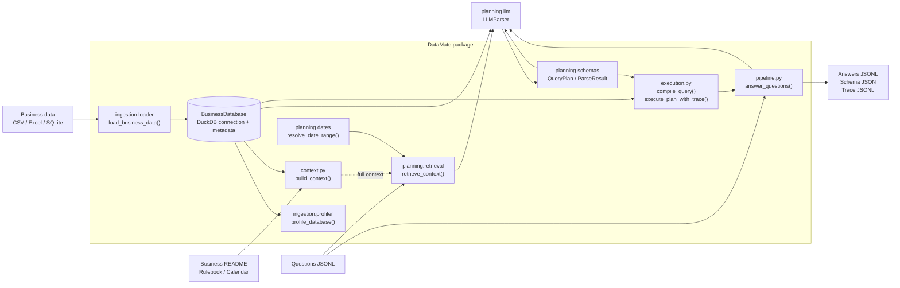
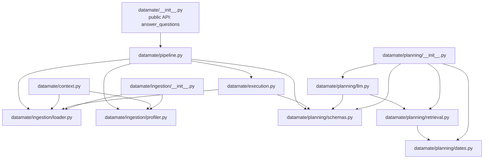
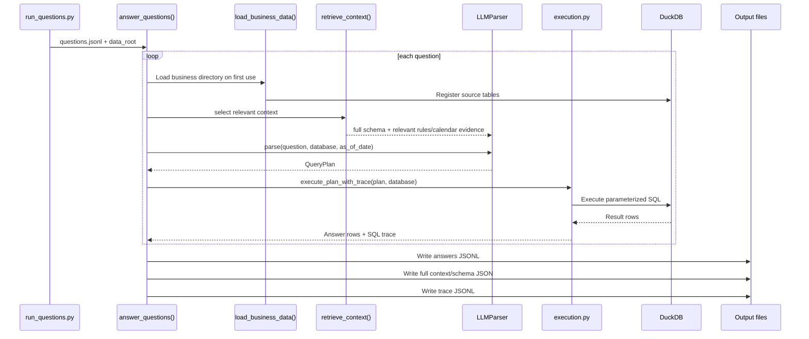

# DataMate Pipeline

> **README outline:** This document is the starting structure for documenting the
> DataMate business-question answering pipeline. Each section identifies the
> module’s responsibility, main interfaces, and place in the end-to-end flow.

## 1. Overview

DataMate converts business files and natural-language questions into
deterministic, competition-compatible JSONL answers.

```text
Business files
    │
    ▼
Ingestion ──► Profiling/context ──► Question planning ──► SQL execution
    │                │                       │                  │
    └────────────── BusinessDatabase ───────┴──────────────► Answers + traces
```

The repository root contains a `canonical_mapping.yml` template. Copy it into
the relevant business directory and define aliases and semantic types before
running ingestion. Without that file, the legacy header-based normalization is
used.

### Primary pipeline stages

1. **Ingest** CSV, Excel, and SQLite sources into DuckDB tables. An optional
   `canonical_mapping.yml` in each business directory maps source table and
   column headers to stable canonical names while retaining raw-name lineage.
   Exact
   duplicate rows in order-keyed exports are removed during ingestion, while
   event tables such as payment records retain duplicate rows.
2. **Profile** tables and columns to produce bounded schema metadata.
3. **Build context** from schemas, business README files, rulebooks, and calendars.
4. **Retrieve relevant context** by scoring tables and columns, selecting
   complete rulebook sections, and resolving only the calendar evidence needed
   for lunar-date questions.
5. **Plan questions** with an OpenAI-compatible LLM endpoint, producing
   validated `QueryPlan` objects.
6. **Compile and execute** parameterized SQL. Execution rejects equality,
   inequality, and membership filters whose values are not present in the
   referenced column, preventing silently ineffective filters.
8. **Write outputs** containing answers, schemas, and execution traces.
   The default `outputs\` directory also contains one folder per question. Each question folder
   contains `answer.json` and an `evidence\` folder with the input,
   loaded-data summary, retrieved context, LLM planner response/plan,
   validated plan, SQL files, query result, and errors, plus
   `token_usage.json`. The aggregate `outputs\token_usage.jsonl` records token
   usage for every question prompt. These files are named
   `04_planner_response.txt` and `05_planner_plan.json` so the evidence format
   is not tied to one model.

## 2. Architecture

The system is a local, batch-oriented pipeline. `BusinessDatabase` is the
shared runtime object between ingestion, profiling, planning, and execution.



## 3. Module dependency diagram



## 4. Runtime pipeline

`run_questions.py` uses `LLMParser` with `--planner llm` to call an
OpenAI-compatible LLM endpoint. The local llama-server preset is the default
and expects the `gemma-local` model alias. To reduce inference latency, select
a remote provider with `--llm-provider` or
`LLM_PROVIDER`, then set the provider's API key:

The Python data pipeline and DuckDB executor do not allocate GPU memory; local
VRAM use comes from the model server. The launchers below set bounded context,
concurrency, and KV cache defaults for local inference.

```powershell
$env:LLM_PROVIDER = "openrouter"
$env:OPENROUTER_API_KEY = "..."
python .\run_questions.py .\questions_samples.jsonl .\public_test\public_test --planner llm
```

The supported presets are `local`, `gemma4-local`, `openrouter`,
`huggingface`, `groq`, and `gemini`. The `gemma4-local` preset uses a separate
local OpenAI-compatible server for the Gemma 4 12B safetensors checkpoint.
Gemini uses Google's OpenAI-compatible endpoint and reads `GEMINI_API_KEY`:

```powershell
$env:LLM_PROVIDER = "gemini"
$env:GEMINI_API_KEY = "your-gemini-api-key"
python .\run_questions.py .\train\train\questions.jsonl .\train\train\data --planner llm
```

Gemini AI Studio currently provides a free tier with request/token quotas;
check the current quota for your account and model. `gemini-3.5-flash-lite` is
the default low-latency model, and `--llm-model` can override it.
`LLM_BASE_URL`, `LLM_MODEL`, and `LLM_API_KEY` override any preset, and the
command-line options `--llm-base-url`, `--llm-model`, `--llm-api-key`,
`--llm-timeout`, and `--llm-request-delay` override environment variables.
Requests are spaced by one second by default to avoid bursting remote model
endpoints; set `LLM_REQUEST_DELAY=0` to disable it or pass a different delay
in seconds. Never commit API keys.
OpenRouter is the most convenient free option for this project because it
offers OpenAI-compatible access and a free router/model options; availability,
rate limits, and model names can change, so override `--llm-model` with a
currently listed Qwen free model when needed.
Hugging Face Inference Providers is a good alternative when a Hugging Face
token and free provider credits are available. Its planner preset uses the
chat-capable `google/gemma-3-12b-it`. `google/gemma-4-12B-it` is not currently
deployed by Hugging Face Inference Providers, so use a separately deployed
OpenAI-compatible endpoint for that model. Groq can be faster, but its
free tier and Qwen model availability should be checked in the account.
Before each model call, deterministic retrieval
includes the full table and column catalog, relevant rulebook sections, resolved
Gregorian time ranges, and minimal lunar-calendar evidence when required.
The selected LLM returns a structurally validated `QueryPlan`. The local
table/column reference validator is disabled by default; DuckDB resolves names
when it executes the generated SQL.

The LLM planner is the default. The CLI uses `.\outputs` as its default output
directory. For an input such as `questions.jsonl`, results are written under
`outputs\questions_answers\`: `answers.jsonl`, `token_usage.jsonl`, and one
folder per question containing its `answer.json` and `evidence\` files.
Use `--evidence-dir PATH` to override the per-question evidence root.



## 5. Package structure

### `datamate/__init__.py`

- Defines the package-level public API.
- Exposes `answer_questions` as the main pipeline entry point.
- **Document here:** supported public imports and API stability expectations.

### `datamate/ingestion/`

Responsible for converting heterogeneous business data sources into a common
in-memory or file-backed DuckDB representation.

#### `datamate/ingestion/loader.py`

- Defines `TableMetadata`, describing table name, source file, sheet, row count,
  and columns.
- Defines `BusinessDatabase`, which owns the DuckDB connection, table metadata,
  load errors, and cached distinct values.
- Implements `load_business_data()`.
- Supports:
  - CSV files: `.csv`
  - Excel files: `.xlsx`, `.xls`
  - SQLite files: `.sqlite`, `.sqlite3`, `.db`
- Normalizes table names and avoids collisions.
- Cleans column names, removes duplicate columns, and converts object values to
  queryable string values.
- Records source-level load errors in `BusinessDatabase.errors`.
- **Document here:** supported formats, naming rules, encoding behavior, and
  connection lifecycle (`close()`).

#### `datamate/ingestion/profiler.py`

- Implements `profile_table()` and `profile_database()`.
- Reports:
  - table source and sheet
  - row counts
  - column names and DuckDB types
  - null ratios
  - distinct counts
  - sample values
  - numeric minimum and maximum values
- Carries ingestion errors into the generated schema.
- **Document here:** why profiling is used instead of sending raw rows to a
  planner or model, and the sample-size trade-off.

#### `datamate/ingestion/__init__.py`

- Re-exports `BusinessDatabase`, `load_business_data`, and `profile_database`.
- **Document here:** the intended ingestion-facing public API.

### `datamate/context.py`

- Implements `build_context()`.
- Combines:
  - profiled database schema
  - `README*` files in the business directory
  - optional rulebook content
  - optional calendar content
- Uses bounded text loading and supports UTF-8, UTF-8 with BOM, and CP1258
  decoding.
- **Document here:** context shape and how business-specific documentation
  influences planning.

### `datamate/planning/`

Converts a natural-language request into a typed, executable query plan.

#### `datamate/planning/schemas.py`

- Defines the planning data contract with Pydantic:
  - `Filter`: column, operator, and value
  - `Metric`: column and aggregation
  - `OrderBy`: metric/group ordering
  - `QueryPlan`: table, metric, filters, grouping, ordering, limits, and answer
    type
  - `ParseResult`: answerable, unanswerable, or abstain status
- Supported operations include aggregation, ranking, grouping, filtering, and
  joins.
- Supported aggregations include sum, average, count, distinct count, minimum,
  and maximum.
- Supported filter operators are `eq`, `neq`, `gt`, `gte`, `lt`, `lte`, `in`,
  `not_in`, `contains`, `between`, `is_null`, and `is_not_null`. The planner
  must emit `not_in` with an underscore; the parser normalizes the known
  human-form alias `not in` before validation. Boolean comparisons use `eq`
  or `neq` with a boolean value.
- **Document here:** validation constraints and the JSON representation of a
  plan.

#### `datamate/planning/dates.py`

- Implements `resolve_date_range()`.
- Resolves Vietnamese date expressions relative to an `as_of_date`, including:
  - today and yesterday
  - current and previous week
  - current month
  - explicit month/year
  - month references without a year
  - calendar quarters (`quý 1` through `quý 4`)
  - beginning of the year
- **Document here:** date semantics, Gregorian calendar assumptions, and
  unsupported expressions. Lunar expressions are resolved through conditional
  calendar retrieval.

#### `datamate/planning/retrieval.py`

- Implements deterministic question-specific context retrieval.
- Includes all tables and columns in the model context.
- Selects relevant rulebook sections and resolves date and calendar evidence.
- Splits rulebooks into complete named sections such as `revenue`, `time`,
  `ranking`, `debt`, and `inventory`; sections are not truncated mid-rule.
- Resolves Gregorian ranges without calendar data.
- Includes minimal `calendar.csv` evidence only for Tết, âm lịch, lunar dates,
  and related expressions.

#### `datamate/planning/llm.py`

- Implements `LLMParser` for an OpenAI-compatible chat-completions endpoint.
- Sends the reduced context produced by `retrieve_context()`.
- Requests one JSON `QueryPlan` and validates the response with Pydantic.
- Does not execute SQL or replace the local execution validator.

#### `datamate/planning/heuristic.py`

- Implements `HeuristicParser`.
- Selects a likely table and columns using normalized Vietnamese/English aliases.
- Infers:
  - revenue and quantity metrics
  - product and group dimensions
  - date filters
  - rankings and top-N limits
  - grouped-by-month requests
  - current-versus-previous-period comparisons
- Provides `parse_result()` for explicit status/reason handling and `parse()` for
  a plan-or-error interface.
- Uses cached distinct values to identify known product values.
- Retained as an offline/reference parser for development and regression tests;
  it is not used by the Qwen command documented below.

#### `datamate/planning/__init__.py`

- Re-exports `HeuristicParser`, `QueryPlan`, and `resolve_date_range`.
- **Document here:** the planning package’s public API.

### `datamate/execution.py`

Responsible for validating plans, compiling SQL, and executing calculations.

- `_validate()` checks table and column references and operation constraints
  when `VALIDATE_PLAN_REFERENCES` is enabled; this check is disabled by default,
  so DuckDB reports unresolved SQL identifiers during execution.
- `compile_query()`:
  - quotes identifiers
  - binds filter values as parameters
  - emits aggregation, grouping, ordering, and limit clauses
  - casts numeric-looking strings before numeric aggregation
- `execute_plan()` returns result rows.
- `execute_plan_with_trace()` returns result rows plus SQL/parameter trace entries.
- Comparison plans are evaluated recursively and returned as a difference or
  percentage change.
- **Document here:** SQL safety, supported filter operators, comparison behavior,
  and grouping limitations.

### `datamate/pipeline.py`

- Implements `answer_questions()`, the end-to-end JSONL pipeline.
- Reads questions and caches one `BusinessDatabase` per business ID.
- Parses each question, validates/builds its `QueryPlan`, and executes it.
- Writes:
  - answer JSONL
  - full context/schema JSON
  - query trace JSONL
- Converts expected planning, input, and DuckDB failures into explicit
  `unanswerable` records while continuing through the question set.
- Closes all loaded databases in a `finally` block.
- **Document here:** input question schema, output schemas, parser interface, and
  error behavior.

## 6. Command-line entry points

### `profile_business.py`

```text
python profile_business.py <data_dir> [-o schema.json]
                         [--db <path>]
                         [--rulebook <path>]
                         [--calendar <path>]
```

- Loads one business directory.
- Builds schema and business context.
- Writes a JSON context document.
- **Document here:** when to use this command and the generated schema format.

### `run_questions.py`

```
python run_questions.py <questions.jsonl> <data_root> [output_dir]
                        [--schema-output <path>]
                        [--trace-output <path>]
                        [--rulebook <path>]
                        [--calendar <path>]
                        [--evidence-dir <path>]
                        [--planner {llm,qwen,heuristic}]
```

- Runs the end-to-end answer pipeline with an LLM by default.
- Use `--planner heuristic` only for the offline/reference parser.
- Produces answers, full contexts/schemas, and traces.
- **Document here:** reproducible execution examples and expected output files.

### `evaluate_questions.py`

Run the pipeline and compare its answers with the reference answers:

```powershell
python .\evaluate_questions.py `
  .\train\train\questions.jsonl `
  .\train\train\data `
  --output .\outputs `
  --planner llm
```

By default, the evaluator reads `answers.jsonl` from the parent directory of
`data_root`. Use `--answers <path>` to override that location.

The procedure invokes `run_questions.py`, then writes
`performance.json` with precision, recall, and F1, plus
`wrong_answers` containing each pipeline output and its correct reference
record. Both files are written into the same
`.\outputs\<question-file-name>_answers` directory as `answers.jsonl`.
Metrics include only questions present in the question file passed to the command.

## 7. Running the pipeline

The commands below assume Windows PowerShell from the repository root.

### Install dependencies

```powershell
python -m venv .venv
.\.venv\Scripts\python.exe -m pip install -r requirements.txt
```

### Start a local Gemma GGUF with llama-server

Place one Gemma `.gguf` model in `models\Gemma`. `start_llama.ps1` starts
`llama-server` on `127.0.0.1:8000`, selects that file, and serves it under the
`gemma-local` model alias. The GGUF file is not included in the repository.

```powershell
$env:LLM_PROVIDER = "local"
$env:LLM_MODEL = "gemma-local"
.\start_llama.ps1
```

The local provider already defaults to `http://localhost:8000/v1` and the
`gemma-local` model alias. Start the server before running questions. The
launcher defaults to a 16,384-token context, one parallel request, automatic
GPU layer placement across devices, and 8-bit K/V cache to reduce VRAM use.
To change the context window, pass `-ContextSize` explicitly:

```powershell
.\start_llama.ps1 -ContextSize 16384
```

The `-CacheTypeK` and `-CacheTypeV` parameters default to `q8_0`; set both to
`f16` if the installed llama.cpp build or model does not support quantized KV
cache. `-GpuLayers` and `-SplitMode` can override automatic layer placement
and the default multi-GPU layer split.

To select a GGUF model stored elsewhere, pass its path explicitly and keep the
alias aligned with `LLM_MODEL`:

```powershell
.\start_llama.ps1 -Model ".\downloads\gemma-3-12b-it-Q4_K_M.gguf" -Port 8000 -Alias gemma-local
```

### Use Gemma 4 12B safetensors as the planner

The checkpoint in `models\gemma-4-12B` is a Hugging Face safetensors model,
not a GGUF file. Serve it with a vLLM build that supports the Gemma 4 12B
Unified architecture. vLLM runs in Linux, so on Windows use WSL2 and install
a build that supports your hardware. See the
[vLLM Gemma 4 guide](https://docs.vllm.ai/projects/recipes/en/stable/Google/Gemma4.html)
for supported builds and hardware notes.

The weights do not need to be uploaded with the codebase. Set
`GEMMA4_MODEL_PATH` to the Hugging Face repo ID to let vLLM download the model
on the Molab machine and cache it there. For a restricted repo, authenticate
with Hugging Face and provide `HF_TOKEN` as a secret environment variable.
Point `HF_HOME` to persistent storage if Molab's default cache is temporary.
The machine needs enough disk space for the model and cache.

From a Molab terminal in the project directory, run:

```bash
export GEMMA4_MODEL_PATH="google/gemma-4-12B"
# Optional, if needed for Hugging Face access:
# export HF_TOKEN="your-token"
# Optional, use a persistent disk for downloads/cache:
# export HF_HOME="/path/to/persistent/hf-cache"
bash ./start_gemma4.sh
```

The launcher also accepts a local model directory (the default is
`models\gemma-4-12B`). It serves on `127.0.0.1:8001` with the model name
`gemma4-12b-planner`, a 16K context window, and image/audio processing
disabled. Its defaults target two GPUs: tensor parallel size 2, one active
sequence, chunked prefill in 2,048-token batches, and a 0.70 per-GPU memory
utilization cap. Adjust `GEMMA4_CONTEXT_SIZE`,
`GEMMA4_GPU_MEMORY_UTILIZATION`, `GEMMA4_TENSOR_PARALLEL_SIZE`,
`GEMMA4_MAX_NUM_SEQS`, or `GEMMA4_MAX_NUM_BATCHED_TOKENS` for a different
hardware setup. Windows applications can reach WSL2 services through
`localhost` on supported Windows versions.

Then choose the new planner preset:

```powershell
python .\run_questions.py .\questions_samples.jsonl .\public_test\public_test `
  --planner llm --llm-provider gemma4-local
```

The planner defaults to `1024` completion tokens to keep generation bounded.
Set `LLM_MAX_TOKENS` in the shell running `run_questions.py` to override it.

The provider defaults to `http://localhost:8001/v1` and
`gemma4-12b-planner`. `LLM_PROVIDER=gemma4-local` selects it by default for
the LLM planner. Thinking mode is disabled for the structured plan response.
The GGUF `local` preset on port 8000 remains available separately.

### Profile one business

```powershell
.\.venv\Scripts\python.exe profile_business.py `
  .\public_test\public_test\data\dev_001 `
  --rulebook .\public_test\public_test\rulebook.md `
  --calendar .\public_test\public_test\calendar.csv `
  --output .\schema.json
```

### Run questions with an LLM

```powershell
$env:LLM_PROVIDER = "local"
$env:LLM_BASE_URL = "http://127.0.0.1:8000/v1"
$env:LLM_MODEL = "gemma-local"
$env:LLM_TIMEOUT = "600"
.\.venv\Scripts\python.exe run_questions.py `
  .\public_test\public_test\questions.jsonl `
  .\public_test\public_test\data `
  .\outputs `
  --rulebook .\public_test\public_test\rulebook.md `
  --calendar .\public_test\public_test\calendar.csv `
  --schema-output .\outputs\schema.json `
  --trace-output .\outputs\trace.jsonl
```

The model receives the full table/column catalog, relevant rulebook sections,
resolved time information, and minimal lunar-calendar evidence when required.
Each question's model context, LLM response, validated plan,
SQL trace, query result, and `answer.json` are stored under
`outputs\<question_id>\`.

### Run tests

```powershell
.\.venv\Scripts\python.exe -m pytest
```

## 8. Data and artifact contracts

### Input data

- One directory per business ID.
- Each directory may contain supported tabular files and a business README.
- Shared rulebooks and calendars may be supplied separately.

### Questions

- JSONL records contain at least:
  - `id`
  - `business_id`
  - `question`
  - `as_of_date`

### Outputs

- Answer records contain `id`, `type`, and `answer`; `type` is selected from
  the query plan's requested result shape (`number`, `percent`, `string`,
  `date`, `boolean`, `list`, or `table`).
- A `list` answer is an ordered JSON array of names or numbers. Its order follows
  the question or, when unspecified, the applicable rulebook default.
- A `table` answer is an object with `columns` and `rows`; each row is an array
  whose values correspond positionally to `columns`. During evaluation,
  columns are matched by normalized name when possible and otherwise by
  position, while rows are compared as a set. String cells use normalized
  string matching and numeric cells use numeric tolerance.
- `unanswerable` and `abstain` records contain `id`, `type`, and a diagnostic
  `reason`.
- Schema output contains per-business table/column profiles and ingestion errors.
- Trace output contains the selected plan and generated SQL parameters.

## 9. Testing

### `tests/test_core.py`

- Covers date resolution.
- Covers parameterized query compilation.
- Covers execution against an in-memory DuckDB database.

### `tests/test_heuristic.py`

- Covers Vietnamese product and date parsing.
- Covers ranking/top-N plans.
- Covers comparison plans and percentage answers.

### `tests/test_retrieval.py`

- Covers table and column selection.
- Covers rulebook section selection.
- Covers Gregorian quarter resolution without calendar data.
- Covers minimal lunar-calendar evidence retrieval for Tết.

### Recommended validation

```text
pytest
```

## 10. Module completeness and improvement plan

The percentages below are an engineering estimate of implementation
completeness, not code coverage. A module is considered complete when its
documented responsibility is implemented, validated for normal inputs, and
has reasonable handling for expected failures. The estimate is based on the
current source and tests; it should be recalculated after major feature work.

| Module | Completeness | What is implemented | What can be improved |
|---|---:|---|---|
| `datamate/__init__.py` | 95% | Exposes the package-level `answer_questions` API. | Add package version metadata and document API compatibility guarantees. |
| `datamate/ingestion/loader.py` | 85% | Loads CSV, Excel, and SQLite files; normalizes names; handles duplicate tables/columns; records source errors. | Add schema/type controls, encoding and malformed-file diagnostics, large-file streaming, and integration tests for every supported format. |
| `datamate/ingestion/profiler.py` | 80% | Produces table/column metadata, null ratios, distinct counts, samples, numeric bounds, and load errors. | Add date/categorical statistics, configurable sampling, safeguards for expensive distinct counts, and profiler tests. |
| `datamate/ingestion/__init__.py` | 90% | Re-exports the intended ingestion API. | Add explicit public type exports and API documentation tests. |
| `datamate/context.py` | 80% | Combines bounded schemas, business README files, rulebooks, and calendars with multiple text encodings. | Add explicit size limits, missing-file diagnostics, deterministic context versioning, and tests for decoding and precedence behavior. |
| `datamate/planning/schemas.py` | 90% | Defines validated filters, metrics, ordering, query plans, and parse statuses with Pydantic constraints. | Add cross-field validation, clearer error codes, and versioned plan serialization for future schema changes. |
| `datamate/planning/dates.py` | 80% | Resolves common Vietnamese relative dates, month/year references, quarters, and year-to-date ranges using Gregorian dates. | Support explicit date ranges, weeks with configurable locale rules, lunar/business calendars, and invalid-date diagnostics. |
| `datamate/planning/retrieval.py` | 85% | Passes the full table/column catalog, selects relevant rulebook sections, resolves Gregorian ranges, and retrieves minimal lunar-calendar evidence. | Improve rulebook section matching and confidence diagnostics. |
| `datamate/planning/llm.py` | 85% | Sends question-specific retrieved context to an OpenAI-compatible LLM endpoint and validates JSON plans. | Add retry policy, prompt/input token telemetry, and model response diagnostics. |
| `datamate/planning/heuristic.py` | 70% | Selects tables and aliases, infers metrics/dimensions, handles filters, rankings, grouping, comparisons, known values, and abstention. | Improve multi-table disambiguation, Vietnamese language coverage, exact filter extraction, aggregation inference, confidence scoring, and parser regression coverage. |
| `datamate/planning/__init__.py` | 90% | Re-exports the planning parser, plan model, and date resolver. | Add explicit exports for `Filter`, `Metric`, `OrderBy`, and `ParseResult` where they are part of the public contract. |
| `datamate/execution.py` | 85% | Validates identifiers, parameterizes values, compiles supported SQL, executes plans, and traces comparison queries. | Add operator validation before compilation, grouped comparisons, null/empty-result semantics, SQL snapshot tests, and performance limits. |
| `datamate/pipeline.py` | 85% | Runs JSONL questions, caches databases, writes answers/schemas/traces, continues after expected question failures, and closes connections. | Validate input/output schemas, stream large JSONL files, isolate per-business failures, improve structured logging, and add end-to-end tests. |
| `profile_business.py` | 80% | Provides a CLI for loading one business, building context, and writing schema output. | Add argument validation, consistent exit codes, structured errors, and CLI tests. |
| `run_questions.py` | 85% | Provides the end-to-end CLI for LLM answers, schema output, evidence bundles, and query traces. | Add strict input validation, progress/error reporting, and reproducibility checks. |

**Estimated overall completeness: 83%.** The highest-priority improvements
are heuristic parser accuracy, broader date and filter handling, integration
tests for real source files, and validation of large-input behavior. These
percentages are separate from the two focused test files currently listed
above; passing tests does not imply that an entire module is complete.

## 11. Technology stack

| Area | Technology | Current use |
|---|---|---|
| Language | Python | Application code and CLI scripts |
| Query engine | DuckDB | In-memory or file-backed analytical database and SQL execution |
| Tabular processing | pandas | CSV/Excel loading and dataframe normalization |
| Excel support | `openpyxl` with pandas Excel readers | Reading `.xlsx` workbooks; `.xls` support depends on the available pandas engine |
| SQLite input | Python `sqlite3` | Reading tables from SQLite database files |
| Data validation | Pydantic 2 | Typed and constrained query-plan models |
| Serialization | Python `json` | JSONL questions/answers, schema output, and execution traces |
| CLI | Python `argparse` | `profile_business.py` and `run_questions.py` command-line interfaces |
| Testing | pytest-style tests | Core execution, heuristic regression, and context-retrieval coverage |

The pinned package versions are maintained in
[`requirements.txt`](requirements.txt). The current implementation does not
depend on a web framework, external database server, or remote model API.

## 12. Limitations and future work

- Expand date-expression coverage, lunar-date handling, and localization.
- Improve table/column disambiguation for multi-table businesses.
- Improve deterministic retrieval confidence and join-candidate selection.
- Add explicit parser support for more filter and grouping forms.
- Extend comparison support to grouped results.
- Add integration tests for CSV, Excel, and SQLite ingestion.
- Document performance expectations for large workbooks and directories.
